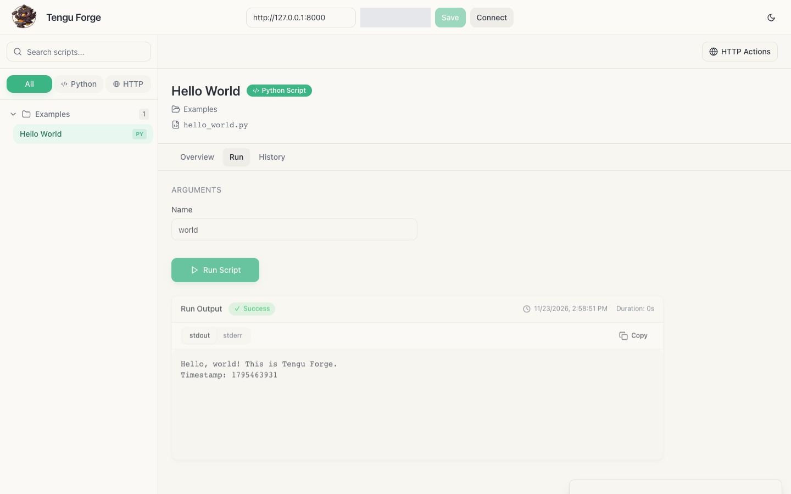

# Tengu Forge

Run a trusted Python script from your browser, inspect its output and exit code, and look up the run later. For work that needs a network request, send a saved HTTP action to a destination you approve.



## Features

- **Script catalog.** Search registered scripts, inspect their arguments and run them in an OS sandbox. A fresh installation includes Hello World.
- **Run history.** Inspect stdout, stderr, timing and exit status for each run. Runs that use declared secrets or environment overrides withhold their output.
- **HTTP actions.** Create, edit and delete request definitions. Confirm **Send** to have the backend issue the request and display its response preview.
- **Local operation.** The launcher starts a React dashboard and a FastAPI service on loopback. A local command provisions the operator’s API key.

## Requirements

Use Python 3.11, Git, Node.js 22 or newer and npm. On macOS the script runner requires `/usr/bin/sandbox-exec`. The Linux implementation requires Bubblewrap at `/usr/bin/bwrap`, system Python at `/usr/bin/python3`, and working user namespaces. The setup and script workflow have been verified on macOS.

## Quick start

Set `REPO_URL` to the clone URL or local path of your copy, then run:

```sh
git clone "$REPO_URL" tengu-forge
cd tengu-forge
python3 -m venv backend/.venv
backend/.venv/bin/python -m pip install -r backend/requirements.txt
npm ci
./launch_tengu.sh
```

1. On first launch, enter and confirm a new API key of at least 16 characters at the terminal prompt.
2. Wait for both Vite’s local URL and Uvicorn’s startup confirmation, then open `http://127.0.0.1:8080`. Leave **API URL** at `http://127.0.0.1:8000`, enter your key, then select **Save** and **Connect**.
3. Select **Hello World → Run → Run Script**. With the default argument, stdout includes `Hello, world! This is Tengu Forge.` Open **History** to inspect the recorded run.

Press **Ctrl+C** in the launcher terminal to stop both services. After a browser refresh, enter your key again.

## Configuration

The supplied setup requires no environment file. Operator-managed state lives under `backend/data/`.

| Setting or file | What it controls | Default or example |
| --- | --- | --- |
| API URL in the top bar | Backend address remembered by this browser | `http://127.0.0.1:8000` |
| API key in the top bar | Credential kept in browser memory for this session | Enter the locally provisioned key |
| `config.json` | Stored verifier used to authenticate API requests | Created by the first-launch prompt |
| `scripts.json` | Registered scripts and their argument definitions | Seeded with Hello World only when the file is absent |
| `http-targets.json` | Exact approved origins and their operator-verified IP addresses | `{"https://api.example.com": "192.0.2.20"}` |

The last row is a documentation example. Supply your service’s actual origin and IP before sending an HTTP action. HTTPS uses the original hostname for certificate verification. Redirects are returned without being followed. Requests have a 15-second timeout and a 64 KiB response preview.

## Add a script

Place your Python file beneath `backend/scripts/`. To try registration using the bundled file, save this definition as `greeting.json` in the repository root:

```json
{
  "id": "greeting",
  "name": "Greeting",
  "type": "python",
  "filePath": "hello_world.py",
  "arguments": [{"name": "name", "label": "Name", "default": "world"}]
}
```

```sh
backend/.venv/bin/python -m backend.app.register_script greeting.json
```

Use a unique ID. Select **Connect** again to refresh the catalog. The runner converts declared arguments into command-line flags. Set `required` for mandatory values, `options` for allowed choices, and `secret` for sensitive arguments. List any permitted environment override names in `allowedEnv`. Put pure-Python helpers next to the script. The sandbox supplies its own interpreter and restricts host file access and networking.

Each worker allows four simultaneous runs. A run has a 30-second deadline and a 128 KiB combined stdout/stderr limit. Use **HTTP Actions** for approved network requests.

## Build and deploy

```sh
npm run build
npm run preview
```

Open the preview address printed by Vite. The frontend builds to `dist/`; script execution and history still require the Python service. For a local deployment, keep the backend on loopback and serve only the static distribution. For example, this Caddyfile serves a copy of the build and proxies API traffic through the same local origin. Set **API URL** to `http://127.0.0.1:4173/api` for this configuration. Replace the root path with the deployed directory, and stop Vite preview before using the same port.

```caddyfile
http://127.0.0.1:4173 {
    bind 127.0.0.1
    handle_path /api/* {
        reverse_proxy 127.0.0.1:8000
    }
    handle {
        root * /srv/tengu-forge/dist
        try_files {path} /index.html
        file_server
    }
}
```

A remote deployment needs a separate access and origin configuration. A remote visitor’s loopback address points to their own machine.

## Security

Provision or rotate the operator key on the backend host:

```sh
backend/.venv/bin/python -m backend.app.services.config_service
```

The service denies requests when key configuration is missing or invalid. Rotating an older plaintext key replaces its stored representation with a salted verifier. Git ignores runtime data and local environment files. Keep them outside the web root.

Register trusted scripts and declare sensitive arguments before the first run. Ordinary arguments and output are retained in `runs.json`; saved HTTP definitions in `http_actions.json` can also contain headers or bodies. Keep credentials out of those definitions. To preview removal of historical payloads, run:

```sh
backend/.venv/bin/python -m backend.app.scrub_history
```

Applying the scrub with `--apply` removes **all** arguments, environment values, stdout and stderr from the selected history while preserving run metadata. Review exported histories and backups separately.

## Project structure

```text
launch_tengu.sh         Starts and stops the local frontend and backend
backend/app/routes/     Authenticated script, history, health and HTTP-action endpoints
backend/app/services/   Sandboxed execution, outbound requests and persistence
backend/scripts/        Trusted Python scripts and bundled example
backend/tests/          Backend regression tests
src/components/         Script catalog, run form, history and action manager
src/hooks/              API client and local connection configuration
src/test/               Frontend tests
```

## Contributing

Issues and pull requests are welcome. For a change to execution or request handling, describe the expected result and include a regression test. Run the checks from the repository root:

```sh
backend/.venv/bin/python -m unittest discover -s backend/tests
npm test
npx --no-install tsc -p tsconfig.app.json --noEmit
```

Contributions are accepted under the same project license.

## License

Copyright © 2026 BotwinDOTTokyo LLC and Prof. M. Botwin. You may use, modify and share Tengu Forge for noncommercial purposes under the PolyForm Noncommercial License 1.0.0. To request permission to sell it or use it commercially, open a repository issue. See the [full license and required notice](LICENSE).
